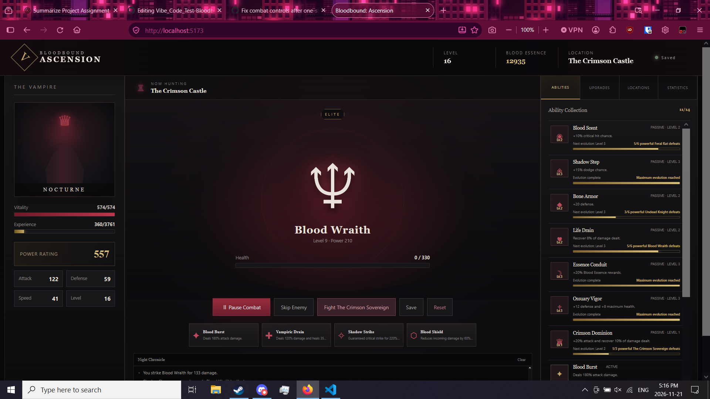
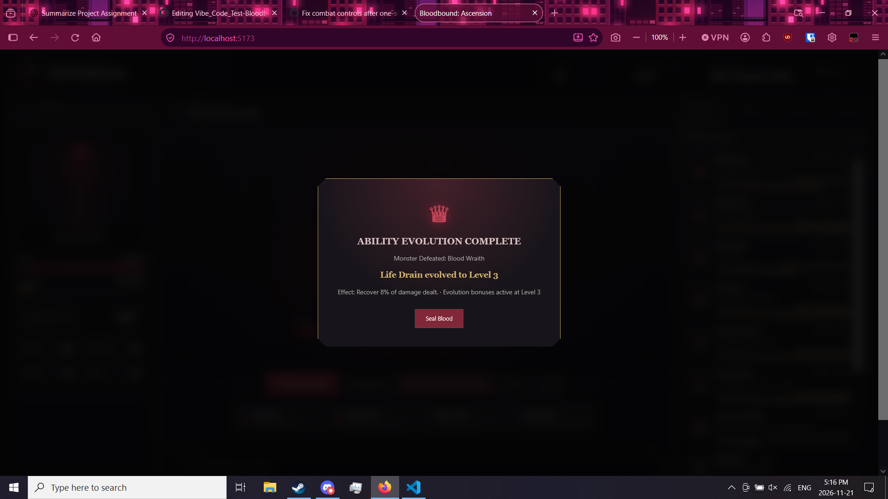

# Bloodbound: Ascension

A browser-based vampire fantasy idle RPG built with TypeScript, HTML5, CSS3, and Vite. Hunt monsters, gain experience and Blood Essence, absorb abilities, evolve your collection, and unlock increasingly dangerous locations.

## Project purpose

This project was created for a college AI-assisted development assignment to demonstrate rapid, modular game development with vanilla web technologies. It includes a complete gameplay loop, browser persistence, and an extensible data-driven design.

## Features

- Automatic combat with pause/resume, enemy skipping, and combat-log controls
- Player leveling, health recovery, diminishing XP rewards for weaker foes, and Power Rating comparisons
- Blood Essence rewards and permanent upgrades that scale in cost
- Blood Absorption for stronger enemies and chance-based absorption for weaker enemy ranks
- Ability evolution at 1, 3, and 6 defeats of the same species
- Four usable active abilities: Blood Burst, Vampiric Drain, Shadow Strike, and Blood Shield
- Passive abilities with combat bonuses and visual evolution progress
- Three locations: the Forgotten Graveyard, Cursed Forest, and Crimson Castle
- Normal enemies, elite enemies, unique area bosses, and boss-specific mechanics
- Boss summons unlocked after 20 enemy defeats in an area
- Area progression unlocked by defeating the previous area's boss
- Death recovery with a temporary 50% XP penalty on the next kill
- Manual save/reset controls and automatic LocalStorage persistence
- Dark gothic interface with responsive layouts, combat feedback, notifications, and accessibility features

## Technologies

- TypeScript
- HTML5
- CSS3
- Vite
- Vitest
- JSDOM
- Browser LocalStorage

## Project structure

```text
src/
├── main.ts                 # Application entry point
├── styles/main.css         # Interface, combat, and responsive styling
├── models/                 # Player, monster, and ability types
├── systems/                # Combat, absorption, progression, and saving
├── data/                   # Monster, ability, and location definitions
└── ui/GameUI.ts            # Interface rendering and event handling
```

## AI development tools

- GitHub Copilot
- Copilot Coding Agent

## Installation

```bash
npm install
```

## Run locally

```bash
npm run dev
```

Open the URL printed by Vite, usually `http://localhost:5173`.

## Testing and production build

```bash
npm test
npm run build
npm run preview
```

`npm run build` type-checks the TypeScript and creates the production bundle in `dist/`.

## Gameplay overview

1. Defeat enemies with automatic combat.
2. Gain experience, level up, and collect Blood Essence.
3. Defeat qualifying stronger monsters to absorb abilities.
4. Evolve absorbed abilities by defeating additional monsters of the same species.
5. Purchase permanent upgrades and improve ability acquisition chances.
6. Defeat 20 enemies in an area to summon its boss.
7. Defeat the area boss to unlock the next location.

## Save data

Progress is stored automatically in browser LocalStorage under `bloodbound-ascension-save-v1`. The Save button writes the current state immediately. Reset Progress removes the saved data after confirmation.

## How AI assisted development

GitHub Copilot and Copilot Coding Agent were used to generate and refine the TypeScript modules, interface, combat balance, save system, boss mechanics, ability evolution, and test coverage. Development prompts and implementation iterations are recorded in [`PROMPT.md`](./PROMPT.md).

## Screenshots

### Main interface



### Ability acquisition



## Future improvements

- Additional locations and monster families
- More evolution tiers and absorbable abilities
- Character portraits and expanded combat animations
- Equipment and additional active abilities
- Offline idle rewards
- Achievement and prestige systems
